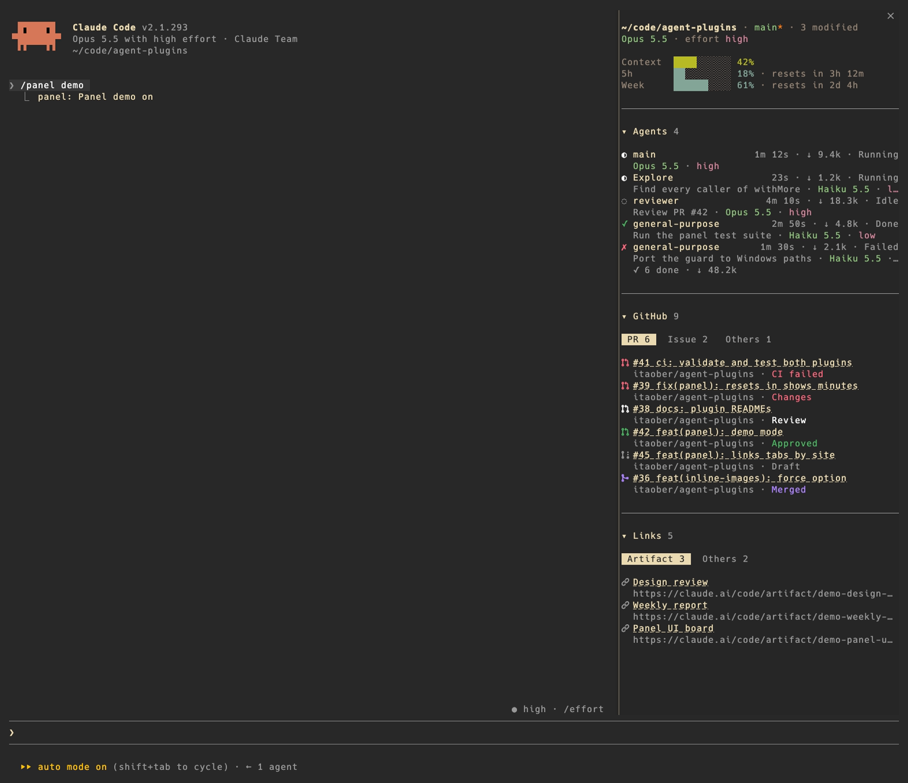
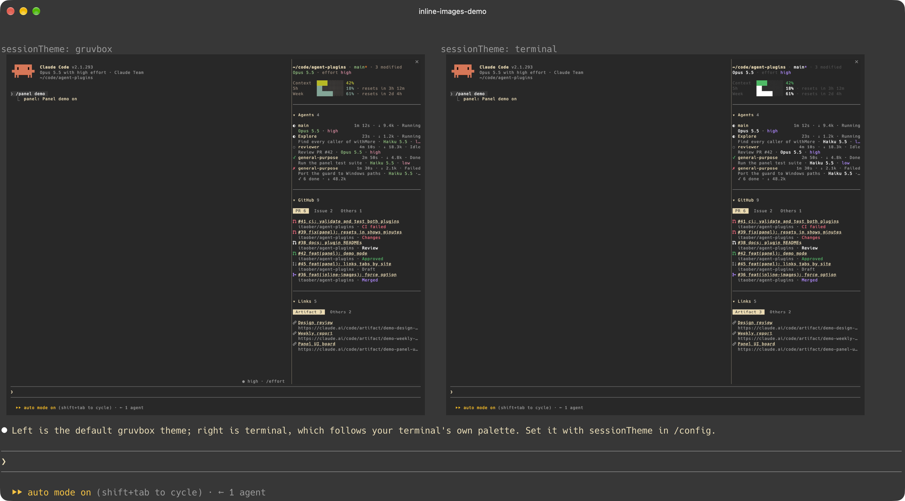

# agent-plugins

Plugins for AI coding agents. Today there are two, both for [Claude Code](https://claude.com/claude-code) 2.1.293 or later.

| Plugin | What it does |
| --- | --- |
| [panel](plugins/panel) | A side pane: session usage, subagents, GitHub PRs / issues and links at a glance |
| [inline-images](plugins/inline-images) | Claude draws PNG screenshots right in the chat (kitty / Ghostty) |

## Install

```sh
claude plugin marketplace add itaober/agent-plugins
claude plugin install panel@itaober
claude plugin install inline-images@itaober
```

Restart Claude Code. Change options in `/config`.

### Installing for a user (AI agents)

1. Check the version: `claude --version` must be 2.1.293 or later.
2. Add the marketplace once: `claude plugin marketplace add itaober/agent-plugins`.
3. Install what the user asked for: `claude plugin install panel@itaober` and / or `claude plugin install inline-images@itaober`.
4. Verify: `claude plugin list` shows each one as enabled.
5. Tell the user to start a new Claude Code session; running sessions do not load new plugins.
6. Mention the requirements: panel shows PR / issue status only when the `gh` CLI is logged in; inline-images only draws in kitty or Ghostty, outside tmux.

Update later with `claude plugin update panel@itaober` (same for inline-images).

## panel



Session usage, every subagent with its tokens, the PRs / issues this session touched with live status, and the links it produced. `/panel` toggles it. [Details](plugins/panel)

## inline-images



Claude shows screenshots inline, stacked or side by side for before / after. [Details](plugins/inline-images)

## Contributing

```sh
git config core.hooksPath .githooks   # privacy guard, once per clone
claude plugin validate plugins/<name>
claude plugin test plugins/<name>
```

CI runs validate and test on every push. The guard blocks credentials, emails, private IPs, home paths and non-English text; put extra private patterns in `.git/info/guard-patterns` (never committed).

## License

[MIT](LICENSE)
