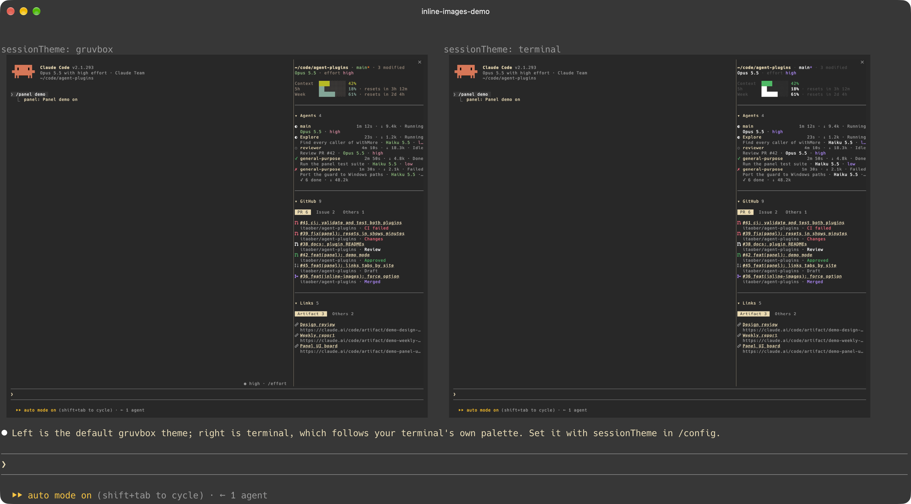

# inline-images

Gives Claude a `show_images` tool that draws PNG screenshots inline in the transcript, one per line or side by side (`layout: "row"`, for before / after). Each image has its caption above it; pressing the caption opens the original in the default viewer.



## Install

```sh
claude plugin marketplace add itaober/agent-plugins
claude plugin install inline-images@itaober
```

## Supported terminals

kitty and Ghostty, outside tmux. The tool is only offered there, so Claude does not waste calls where nothing can be drawn.

iTerm2, sixel terminals and every other terminal show the alt text (caption and path) instead of pixels: Claude Code itself only draws images in kitty and Ghostty, and nothing a plugin does can change that. The desktop app and `claude -p` never get the tool.

## Options

Change them in `/config`.

| Option | Type | Default | Meaning |
| --- | --- | --- | --- |
| `force` | boolean | `false` | Offer the tool even when the terminal is not detected as kitty or Ghostty, e.g. when ssh or sudo rewrote `TERM` / `TERM_PROGRAM`. Still terminal sessions only. |

## Limitations

- PNG only, absolute paths, at most 4 images per call.
- A PNG over 4 MiB still draws, but its aspect ratio is guessed (16:10).
- Side by side falls back to stacked when each image would get fewer than 40 columns.
- Pressing a caption runs `open`, so it works on macOS only; elsewhere it shows "Cannot open".

## Develop

```sh
claude --plugin-dir plugins/inline-images   # load from disk; saving a file reloads it
claude plugin validate plugins/inline-images
claude plugin test plugins/inline-images
tsc -p plugins/inline-images                # once a --plugin-dir session has written .claude-plugin/types/
```
