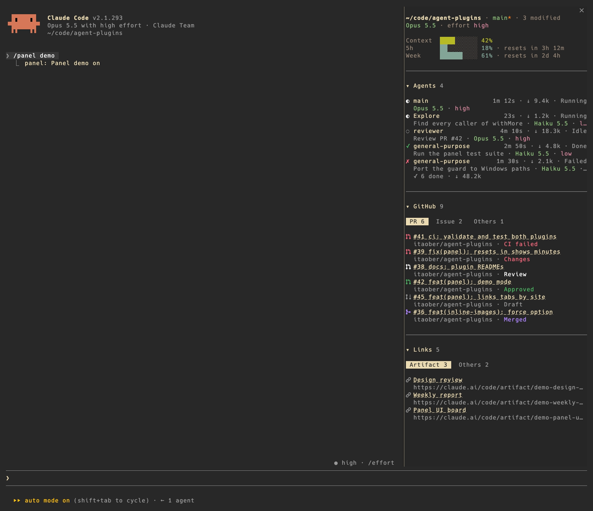

# panel

A pane beside the chat that shows what this session is doing.



| Section | Shows |
| --- | --- |
| Session | Directory, git branch, model and effort, context, 5-hour and weekly usage with reset times |
| Agents | Main thread and every subagent: state, duration, tokens, model, effort |
| GitHub | PRs / issues you pasted or `gh` touched, with live status; tabs for PR, Issue, Others |
| Links | Links you pasted or a tool published (Artifacts, MCP results, dev servers), tabbed by site; untitled ones get a short Haiku-written title from what came with them |

Hover a row for copy and ×. Section titles fold.

Ask Claude to put any link into the panel ("put this link in the panel") and it calls the plugin's `add_link` tool, filing it at the top of Links with a summary title.

## Install

```sh
claude plugin marketplace add itaober/agent-plugins
claude plugin install panel@itaober
```

## Commands

| Command | Does |
| --- | --- |
| `/panel` | Open or close the pane (remembered across sessions) |
| `/panel demo` | Toggle fictional demo data, for screenshots |

## Options

Set in `/config`. Invalid values fall back to the default.

| Option | Default | Meaning |
| --- | --- | --- |
| `showSession` `showAgents` `showGit` `showLinks` | `true` | Show each section (GitHub off = `gh` never runs) |
| `width` | `46` | Pane width in columns |
| `autoOpen` | `true` | Open the pane when a session starts |
| `visibleRows` | `6` | Rows per section or tab before "+N more" |
| `tabThreshold` | `3` | Links from one site needed for its own Links tab |
| `ghRefreshSeconds` | `60` | How often open PRs / issues are rechecked; `0` = once |
| `agentsKeep` | `10` | Minutes a finished agent keeps its row before folding into the summary; `0` = never fold |
| `gitSort` | `attention` | PR / issue order: `attention` (needs action first), `recent`, `repo` |
| `sessionLines` | `dir,model,context,5h,week` | Session lines to show, in order |
| `sessionBars` | `true` | Bars before percentages |
| `sessionTheme` | `gruvbox` | Colors: `gruvbox`, `hud` (matches claude-hud), `terminal` |

## Limitations

- Terminal only; the pane docks when the terminal is at least 144 columns wide.
- PR / issue status needs the `gh` CLI, logged in.
- Icons are Nerd Font Octicons: use a Nerd Font, or Ghostty (built in).
- Pressing an agent opens `/tasks`; the plugin API cannot jump to an agent's transcript.
- Token counts reset when Claude Code restarts.
- A subagent's duration and tokens follow Claude's tasks bar, since the engine gives no running totals: both cover its current run only and start over when SendMessage resumes it. Tokens are the run's last request input (cache included) plus the run's output so far. The main row still sums output tokens.
- A subagent's state is checked against the engine's agent list every 2 s while one is live, so a stop (TaskStop, or stopping it yourself) shows as Aborted within 2 s. One the list has already dropped while it still read Running also shows as Aborted, since how it ended is unknown.

## Develop

```sh
claude --plugin-dir plugins/panel     # load from disk, reloads on save
claude plugin validate plugins/panel
claude plugin test plugins/panel
```
